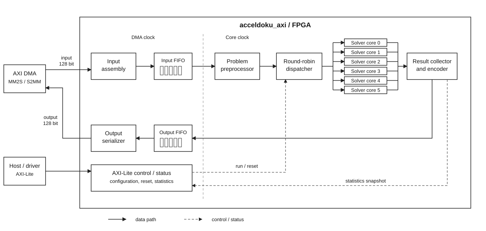
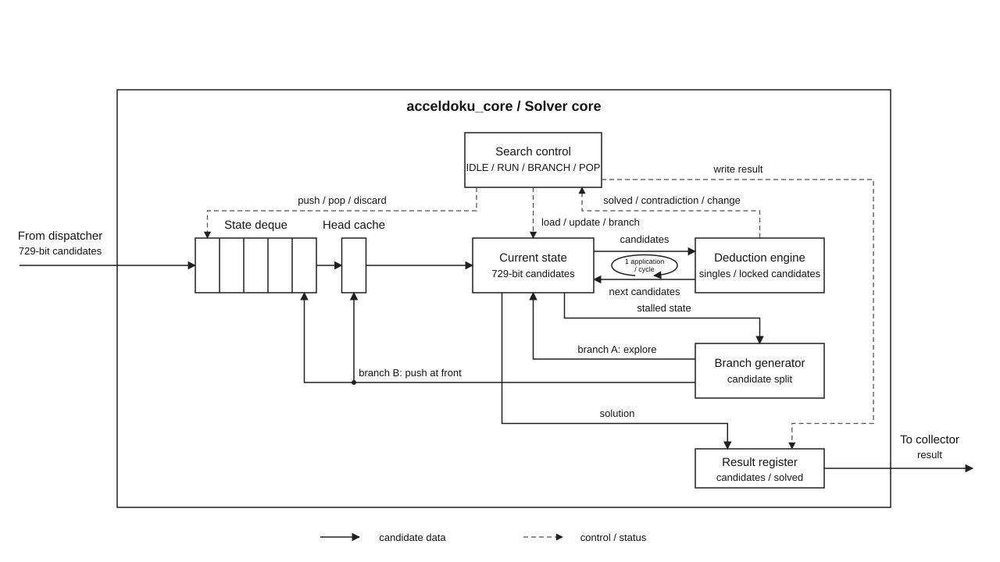

# Acceldoku: FPGA-Accelerated Deductive and Explorative Sudoku Solver

## Overview

Acceldoku is a high-throughput Sudoku solver accelerator that combines parallel application of deduction rules with depth-first search.
Optimized for continuously processing large numbers of puzzles, it solves the 17-clue corpus at **27.623M solves/s** and the `HardestDatabase110626` corpus at **0.814M solves/s** on a KV260 (K26 SOM).
These rates are respectively **5.24× and 3.65×** those of fastdoku running with 16 threads on a Ryzen 7 PRO 6850U.

## Results

The following results compare repeated submissions using `acceldoku_benchmark` on the KV260 with [fastdoku](reference/fastdoku/README.md) on a Ryzen 7 PRO 6850U development machine.
Rates are in **M solves/s (million puzzles per second)**.

| Corpus                            |   Puzzles | KV260 FPGA | fastdoku, 1 thread | fastdoku, 16 threads |
|-----------------------------------|----------:|-----------:|-------------------:|---------------------:|
| Kaggle 1 million Sudoku games     | 1,000,000 |     31.225 |              2.087 |               14.759 |
| `puzzles1_unbiased`               | 1,000,000 |     30.128 |              0.754 |                5.504 |
| `puzzles2_17_clue`                |    49,158 |     27.623 |              0.713 |                5.270 |
| `puzzles3_magictour_top1465`      |     1,465 |      5.512 |              0.200 |                1.428 |
| `puzzles4_forum_hardest_1905`     | 2,135,371 |      1.067 |             0.0551 |                0.397 |
| `puzzles5_forum_hardest_1905_11+` |    48,766 |      0.936 |             0.0480 |                0.341 |
| `puzzles6_forum_hardest_1106`     |       375 |      0.814 |             0.0319 |                0.223 |
| `puzzles7_serg_benchmark`         |    10,000 |     17.193 |              0.814 |                5.881 |

Measurement conditions:

- **FPGA:**
  - KV260, 6-core implementation
  - Core clock: 115.385 MHz; DMA clock: 187.5 MHz
  - Median of three runs, each repeatedly submitting the corpus for 60 seconds with 8 input and 64 output buffers
  - Output contents were not read; only the number of results was counted
- **CPU:**
  - Ryzen 7 PRO 6850U
  - fastdoku `auto`, built with native optimizations
  - Median of three runs, each repeatedly finding the first solution for 60 seconds after a 1-second warm-up
  - Threads were created before measurement; solutions were discarded and only the count was recorded

## Architecture


|  |
|:----------------------------------------------------------------:|
| Block diagram of the accelerator                                 |

|  |
|:-----------------------------------------------------------:|
| Block diagram of an individual solver core                  |

Each core solves puzzles by updating a 729-bit candidate matrix register, with nine flag bits per cell.
The deduction engine applies the Singles and Locked Candidates rules across the entire board in parallel on every cycle.
Repeated application of these rules to the candidate matrix produces chains of deductions.

New puzzles are supplied to the deduction engine through a BRAM-based deque used as a queue.
When deduction stalls, the engine selects an unresolved cell with the fewest candidates and splits its candidate bits into two sets. It continues deduction on one set immediately and pushes the other onto the front of the deque.
On a contradiction, it discards the current candidate matrix and takes another state from the front of the deque.
When a solution is found, the remaining branches in the deque are discarded.

The same deque therefore serves as both a queue for incoming puzzles and a stack for backtracking.

## Build & Usage

### Requirements

- Development machine
  - Synthesis and implementation:
    - CMake 3.25 or later
    - Ninja
    - Vivado 2026.1 or later, with K26 device support and `dtc`
  - Verification:
    - `build-essential`
    - Rust / Cargo 1.83 or later
    - Python 3
    - Icarus Verilog
    - Verilator
    - Yosys
    - Vivado 2026.1
- KV260
  - Ubuntu 24.04
  - `build-essential`
  - CMake 3.25 or later
  - Ninja
  - Python 3
  - Rust / Cargo 1.83 or later
  
The versions of `rustc` and `cargo` available via `apt` may be outdated.
To install latest versions, use `rustup` (which is available through `apt`).

```sh
apt install rustup
rustup default stable
```

### Generate FPGA firmware

On the development machine, synthesize and implement the design, then generate the bitstream and Device Tree overlay.
The output is placed in `build/kv260-pl/fpga/kv260/firmware/acceldoku/`.

```sh
cmake --preset kv260-pl
cmake --build --preset kv260-pl
```

The following options can be passed when configuring the preset:

- `-DACCELDOKU_CORES`: number of solver cores implemented in hardware (1–6; default: 6)
- `-DACCELDOKU_VIVADO_JOBS`: number of cores used by Vivado

### Build and load on the KV260

Transfer the source and generated firmware directory to the KV260.
Running `git clone --recursive https://github.com/void-hoge/acceldoku.git` also clones the submodule.

Install the required packages on the board's Ubuntu system. Separately install Rust / Cargo 1.83 or later and add it to `PATH`.

```sh
sudo apt install build-essential cmake ninja-build python3 "linux-headers-$(uname -r)"
```

Build the driver and tools:

```sh
cmake --preset kv260-ps
cmake --build --preset kv260-ps
```

This generates `build/kv260-ps/host/driver/src/acceldoku.ko`, the C/C++ tools, and the C++ library.
The module is built against the headers for the running kernel.

In a root shell on the board, specify the path to the transferred firmware and load it.
First close any programs and memory mappings currently using the device.

```sh
FIRMWARE_DIR=/path/to/copied/firmware/acceldoku
mkdir -p /lib/firmware/xilinx/acceldoku
cp "$FIRMWARE_DIR"/* /lib/firmware/xilinx/acceldoku/
if test -d /sys/module/acceldoku; then rmmod acceldoku; fi
xmutil unloadapp
xmutil loadapp acceldoku
xmutil listapps
insmod build/kv260-ps/host/driver/src/acceldoku.ko
ls -l /dev/acceldoku
```

### Run and verify

Once `/dev/acceldoku` is available, run the benchmark. Input consists of one puzzle per line, with 81 cells per puzzle and `.` or `0` representing an empty cell.

```sh
# Arguments: corpus, input buffers, output buffers, measurement time in seconds
build/kv260-ps/host/tools/cpp/acceldoku_benchmark sim/data/17puz49158.txt 8 64 10
# Argument: corpus
build/kv260-ps/host/tools/cpp/acceldoku_verify sim/data/17puz49158.txt
```

The benchmark repeatedly submits the corpus for the specified duration and counts the output results.
`acceldoku_verify` submits each puzzle once and compares output checksums against fastdoku.

### Tests

To run CPU reference and RTL tests on the development machine, initialize the submodule and run:

```sh
cmake --preset dev
cmake --build --preset dev
ctest --preset dev
```

## License

- MIT

### Corpora

| Corpus                                                                     | Puzzles | Original source and collection                                                                                                                                                                                                                                 |
|----------------------------------------------------------------------------|--------:|----------------------------------------------------------------------------------------------------------------------------------------------------------------------------------------------------------------------------------------------------------------|
| [`sim/data/17puz49158.txt`](sim/data/17puz49158.txt)                       |  49,158 | [dobrichev's collection](https://sites.google.com/site/dobrichev/sudoku-puzzle-collections) and [additional puzzles](http://forum.enjoysudoku.com/scan-solution-grids-for-17-clues-as-of-blue-t34012-90.html#p282968), based on Gordon Royle's 17-clue corpus. |
| [`sim/data/HardestDatabase110626.txt`](sim/data/HardestDatabase110626.txt) |     375 | [HardestDatabase110626.txt](http://forum.enjoysudoku.com/the-hardest-sudokus-new-thread-t6539.html#p65791) from the Enjoy Sudoku forum.                                                                                                                        |
|                                                                            |         |                                                                                                                                                                                                                                                                |
