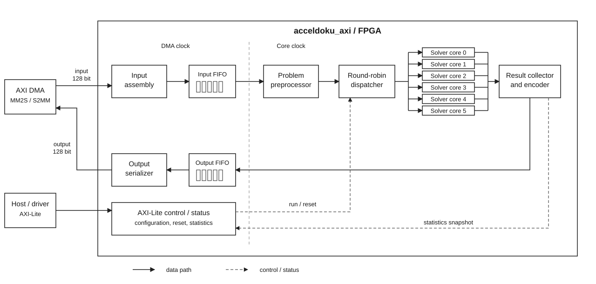
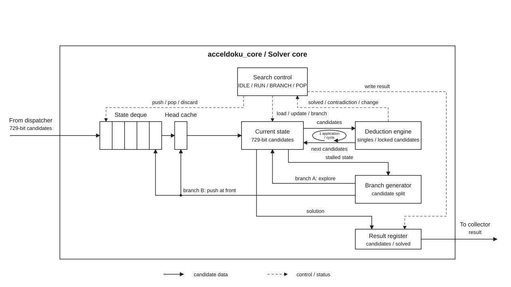

# Acceldoku ブロック図

## アクセラレーター全体

実線はデータ経路、破線の矢印は制御・統計を表す。灰色の破線は DMA とコアのクロック境界を示す。

- AXI DMA は 128 bit AXI4-Stream で問題と結果を転送する。入力は 4 ビートを 64 バイトのレコードに組み立て、結果は 4 ビートに分割する。
- 非同期 FIFO を介してクロックドメインをまたぎ、前処理後の問題をラウンドロビンでソルバーコアに配送する。ID と不正セル情報は結果収集時に対応付ける。
- KV260 の既定構成は 6 コア。DMA クロックは 187.5 MHz、コアクロックは約 115.385 MHz。出力順は入力順とは限らない。
- AXI-Lite で実行・リセット・転送設定を行い、統計スナップショットを取得する。

## ソルバーコア内部

実線は候補データと結果の経路、破線は主な制御・状態情報を表す。制御線のラベルは動作の概略であり、独立した命令コードを表すものではない。

- deque は新規問題と深さ優先探索の保留枝を保持し、head cache を経由して current state にロードする。保留枝は取り出し側の先頭に積む。
- 推論が進む間は候補を更新する。推論が止まると候補を 2 枝に分割し、branch A を探索しながら branch B を deque に保留する。
- 矛盾した場合は保留枝を取り出し、解が見つかるか保留枝がなくなれば結果を返す。解が見つかったときは残りの保留枝を破棄する。

図は [`images/block_diagram.svg`](images/block_diagram.svg) と [`images/core_block_diagram.svg`](images/core_block_diagram.svg) を直接編集する。

詳細は [`rtl/acceldoku.sv`](rtl/acceldoku.sv)、[`rtl/acceldoku_core.sv`](rtl/acceldoku_core.sv)、[`rtl/acceldoku_axi.sv`](rtl/acceldoku_axi.sv)、[KV260 ボード実装](fpga/kv260/README.md)を参照。
